# Guide d’utilisation — NOVA Hospitality

Ce guide décrit l’utilisation de **NOVA Hospitality** (Django) : installation, comptes de démonstration, navigation, et procédures pour chaque rôle (Superadmin, Gérant, Réceptionniste, Chef de cuisine, Serveur, Barman, Caissier).

> Interface disponible en français. Les libellés et montants affichés dans l’application correspondent à la devise/configuration de l’établissement.

---

## 1. Prérequis et installation

### Prérequis
- Python 3 avec l’environnement du projet (`venv` recommandé)
- Dépendances : `pip install -r requirements.txt`
- Base de données : **SQLite** (`db.sqlite3` à la racine du projet)

### Démarrage rapide
```bash
python3 -m venv .venv
source .venv/bin/activate
pip install -r requirements.txt
python3 manage.py migrate
python3 manage.py seed_demo
python3 manage.py runserver
```

- Application : http://127.0.0.1:8000/
- Connexion équipe : http://127.0.0.1:8000/login/
- Arrêt du serveur : `Ctrl+C`

### Commandes utiles
```bash
python3 manage.py check
python3 manage.py test
python3 manage.py seed_demo   # idempotent : crée/met à jour groupes, comptes et données de démo
```

### Réinitialisation complète (nouveau départ)
Pour repartir d’une base vierge (supprime toutes les données) :
```bash
# supprimer la base puis recréer le schéma et les données de départ
rm -f db.sqlite3
python3 manage.py migrate
python3 manage.py seed_demo
```
> Les migrations applicatives sont fournies dans le dépôt. Une réinitialisation efface l’historique et les enregistrements existants.

---

## 2. Comptes et rôles de démonstration

Après `python3 manage.py seed_demo`, les comptes suivants sont disponibles (groupe/rôle indiqué) :

| Rôle | Identifiant | Mot de passe | Espace par défaut |
|---|---|---|---|
| Super administrateur | `Superadmin` | `Super@Nova2026` | Administration système |
| Gérant | `Owner` | `Owner@Nova2026` | Gérance (vue consolidée) |
| Chef de cuisine | `Chef` | `Chef@Nova2026` | Cuisine (KDS) |
| Réceptionniste | `Receptionist` | `Reception@Nova2026` | Réception |
| Serveur | `Waiter` | `Serveur@Nova2026` | Service salle & bar |
| Caissier | `Cashier` | `Caissier@Nova2026` | Caisse |
| Barman | `Bartender` | `Barman@Nova2026` | Bar |

> **Sécurité** : ces mots de passe sont destinés à la démonstration. Modifiez-les (et créez vos propres comptes) avant toute utilisation réelle.

---

## 3. Connexion, navigation et principes généraux

- **Connexion / déconnexion** : `/login/` et menu de déconnexion (POST). Après connexion, chaque utilisateur est redirigé vers l’espace de travail de son rôle (`/workspace/...`).
- **Tableau de bord / console** : `/` redirige vers l’espace de travail selon le rôle ; les gérants/superadmins disposent d’une vue consolidée et des modules.
- **Recherche globale** : barre de recherche (clients, chambres, réservations, factures, produits, plats) selon accès.
- **Modules** (accès selon rôle) : Hôtel, Restaurant, Bar, Inventaire, Finance, Clients & équipe.
- **Impression & tickets** : factures, reçus et commandes disposent d’aperçus/impressions et de tickets POS (format 80 mm) via les boutons dédiés ou `?ticket=1`.
- **Documents / rapports** : `/reports/` (aperçu, génération PDF/CSV, historique) selon les droits du rapport.
- **Bilan financier** : `/workspace/finance/balance/` (Superadmin et Gérant) — filtre par période, encaissements par activité (Hôtel/Restaurant/Bar), dépenses et solde net.
- **OBR eBMS** : `/obr-ebms/` visible et accessible uniquement si le module est activé pour l’établissement et selon le rôle.

### Aperçu de l’interface

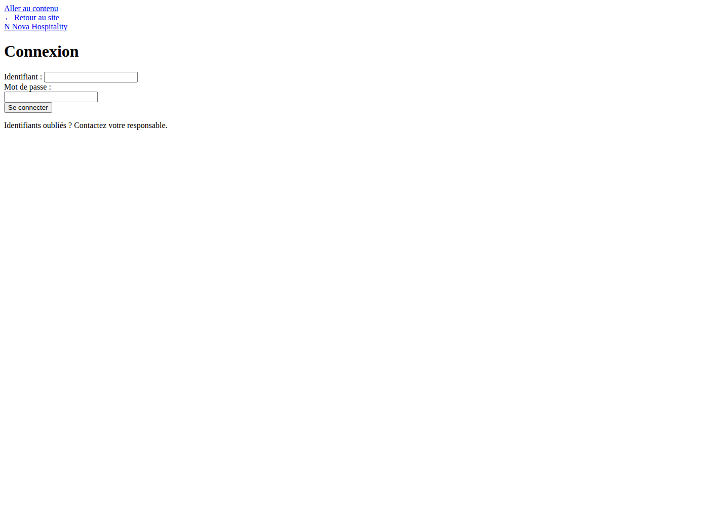
*Page de connexion de l’équipe.*


*Recherche globale dans la console.*

### Données de démonstration incluses
Le seed initialise notamment : types/chambres et tarifs, clients, réservations/séjours/tâches ménage, tables/menus/plats et commandes restaurant, tables/boissons et commande bar, produits/stocks/mouvements/fournisseur/recette, factures/paiements/dépenses et paramètres de base (moyens de paiement, catégories).

---

## 4. Site public (vitrine)

Pages accessibles sans connexion (selon configuration) : accueil, à propos, chambres, menu restaurant, bar.
- Consultation des chambres, plats et boissons.
- **Demande de réservation web** (depuis une chambre) : le visiteur saisit dates, voyageurs et coordonnées ; la demande apparaît en réception pour traitement/conversion. Les informations de contact et de présentation dépendent du profil de l’établissement.

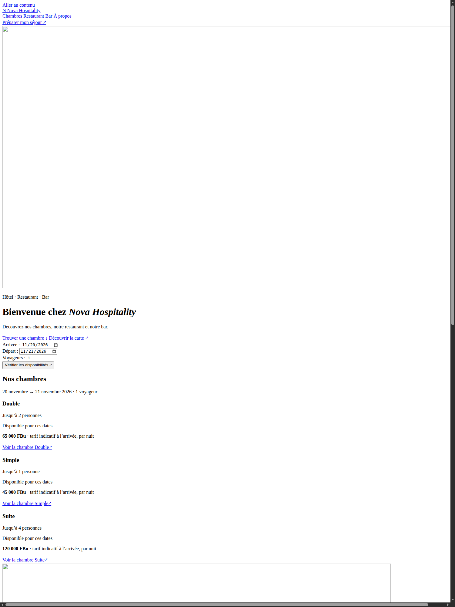
*Page d’accueil publique (vitrine).*

---

## 5. Guides par rôle

### 5.1 Super administrateur (`Superadmin`)
**Objectif** : supervision technique et globale de la plateforme.

- **Espace** : Administration système — indicateurs (comptes, opérations en cours, encaissé/à encaisser, anomalies), activité par module, journal d’audit récent, équipe, stocks critiques, derniers paiements.
- **Accès** : tous les modules, espaces de travail, rapports et (si activé) OBR eBMS. Peut effectuer les opérations opérationnelles (y compris encaissement) en tant que superutilisateur.
- **Bilan financier** : `/workspace/finance/balance/` — analyse par période (Hôtel, Restaurant, Bar, dépenses, solde net, montants à encaisser).
- **Administration** : `/admin/` (Django) pour la configuration avancée, la gestion des comptes/mots de passe/groupes et le profil établissement.
- **OBR eBMS** : peut activer le module pour l’établissement via le profil société (réglage réservé au super administrateur), puis configurer/utiliser le module OBR.
- **À noter** : le journal d’audit est destiné au suivi/consultation des opérations sensibles.

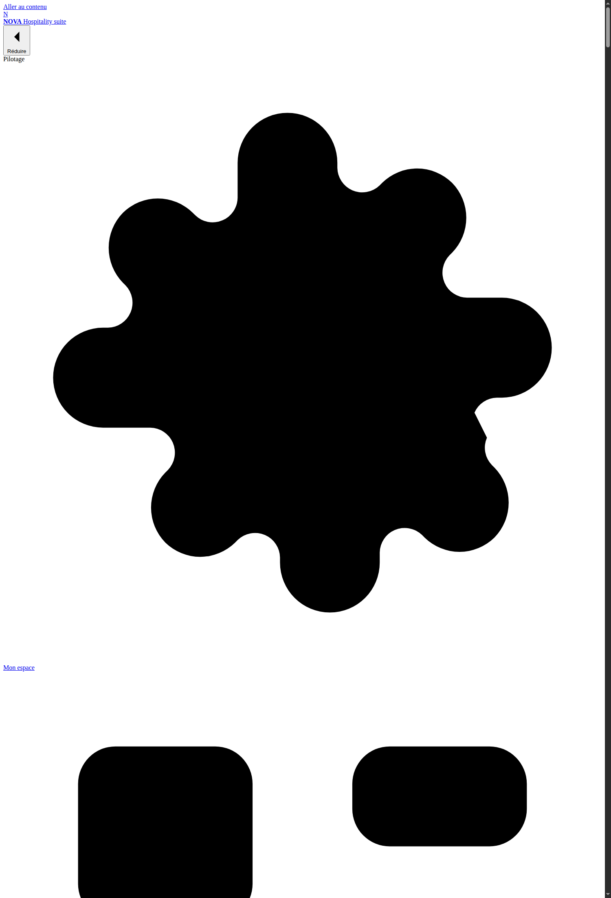
*Tableau de bord d’administration système.*

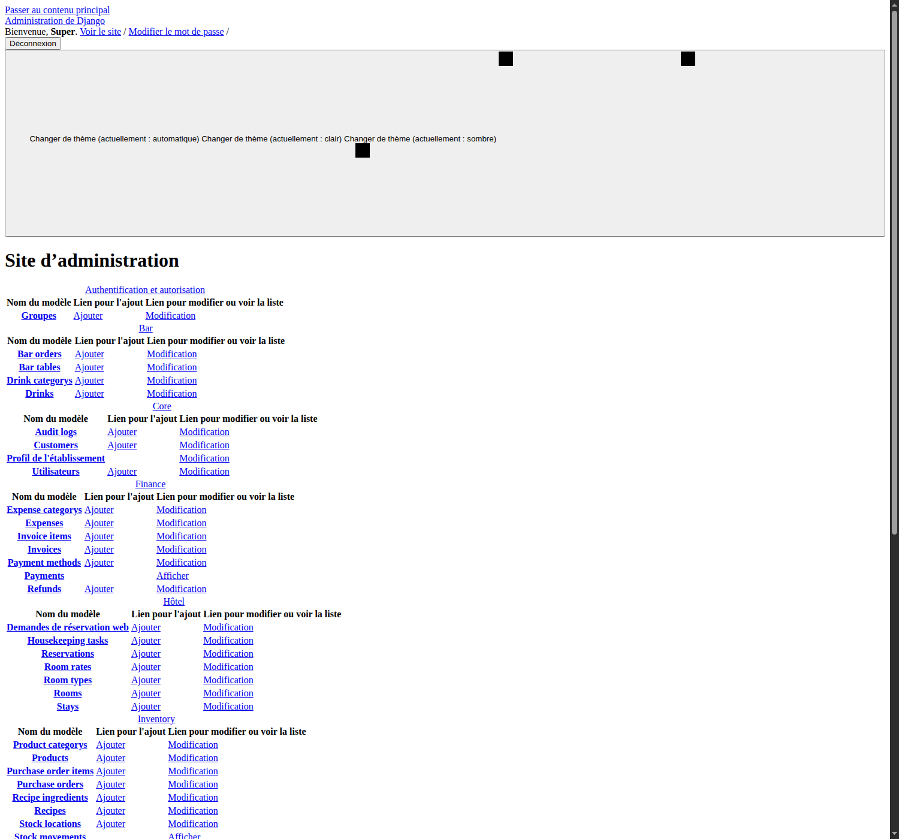
*Interface d’administration (comptes, configuration).*

### 5.2 Gérant (`Owner`)
**Objectif** : pilotage consolidé et contrôle des opérations hôtel/restaurant/bar.

- **Espace** : Gérance — chiffre d’affaires d’activité, encaissé, à encaisser, bénéfice estimé, occupation, répartitions et classements (plats, boissons, tables), factures/paiements/dépenses récents, stocks et achats.
- **Accès** : tous les espaces opérationnels (Réception, Cuisine, Service, Bar, Caisse) et tous les modules ; rapports et OBR eBMS (si activé).
- **Bilan financier** : `/workspace/finance/balance/` — filtre début/fin, encaissements par activité, dépenses et solde net.
- **Finance & encaissement** : peut préparer/contrôler et **encaisser** les factures (caisse), et suivre les soldes.
- **Bonnes pratiques** : utiliser le bilan et les rapports pour rapprocher encaissé, à encaisser et dépenses sur une période.

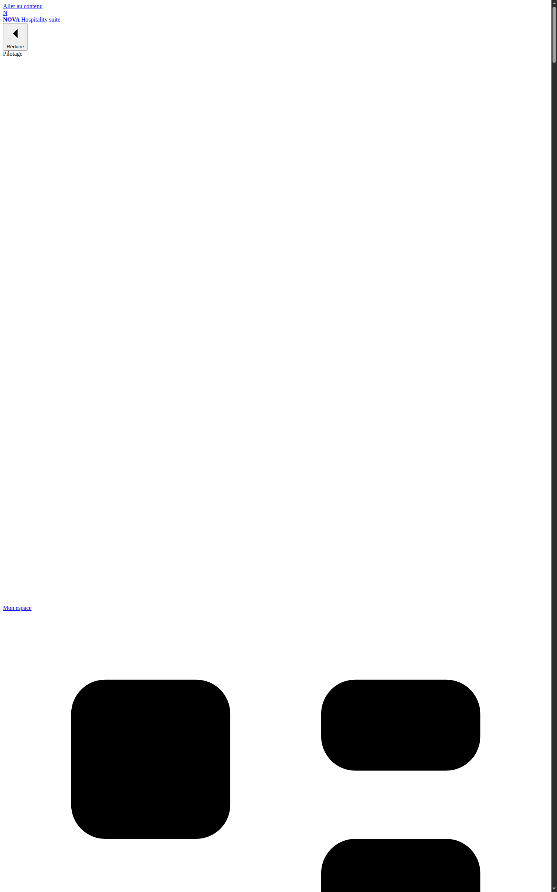
*Vue consolidée de l’établissement (gérance).*

### 5.3 Réceptionniste (`Receptionist`)
**Objectif** : gérer les arrivées/départs, les réservations et le ménage.

- **Espace** : Réception — chambres (disponibilité/statut), arrivées/départs du jour, calendrier, demandes de réservation web, réservations et tâches de ménage.
- **Demandes web** : consulter, marquer traitée/rouvrir, convertir en réservation avec préremplissage (client/chambre/dates) selon disponibilité.
- **Réservations** : créer/modifier (brouillon ou confirmée), associer client et chambre.
- **Séjour** : 
  - *Check-in* : pour une réservation confirmée.
  - *Préparer le départ* : génère/rattache la facture de séjour.
  - *Check-out* : possible uniquement lorsque le solde de la facture est réglé (la réception ne peut pas encaisser si elle n’a pas le rôle de caisse).
- **Housekeeping** : mettre à jour le statut des tâches de ménage.
- **Restaurant** : peut créer des commandes restaurant et transmettre l’addition à la caisse ; **ne peut pas encaisser**.
- **Accès modules** : Hôtel, Restaurant, Clients & équipe.

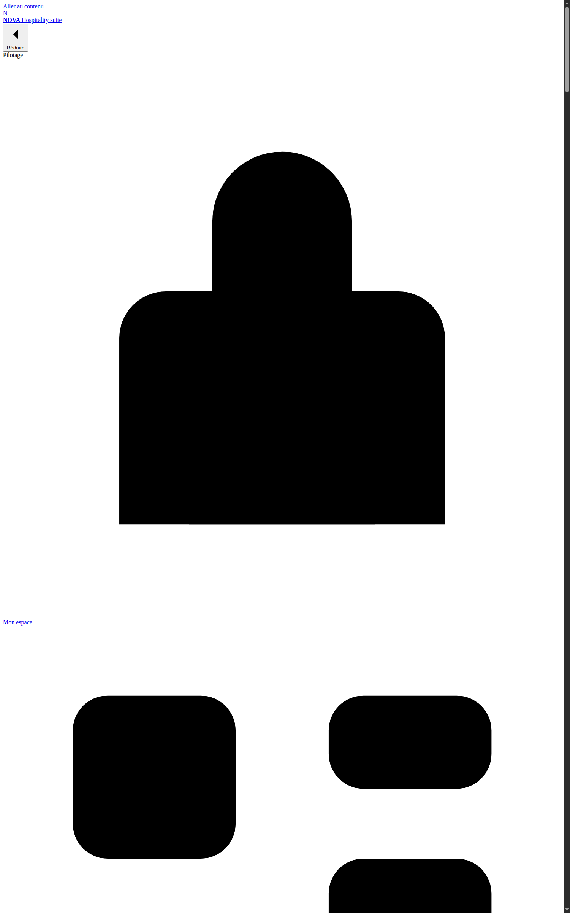
*Espace de travail réception (chambres, arrivées/départs, demandes).*

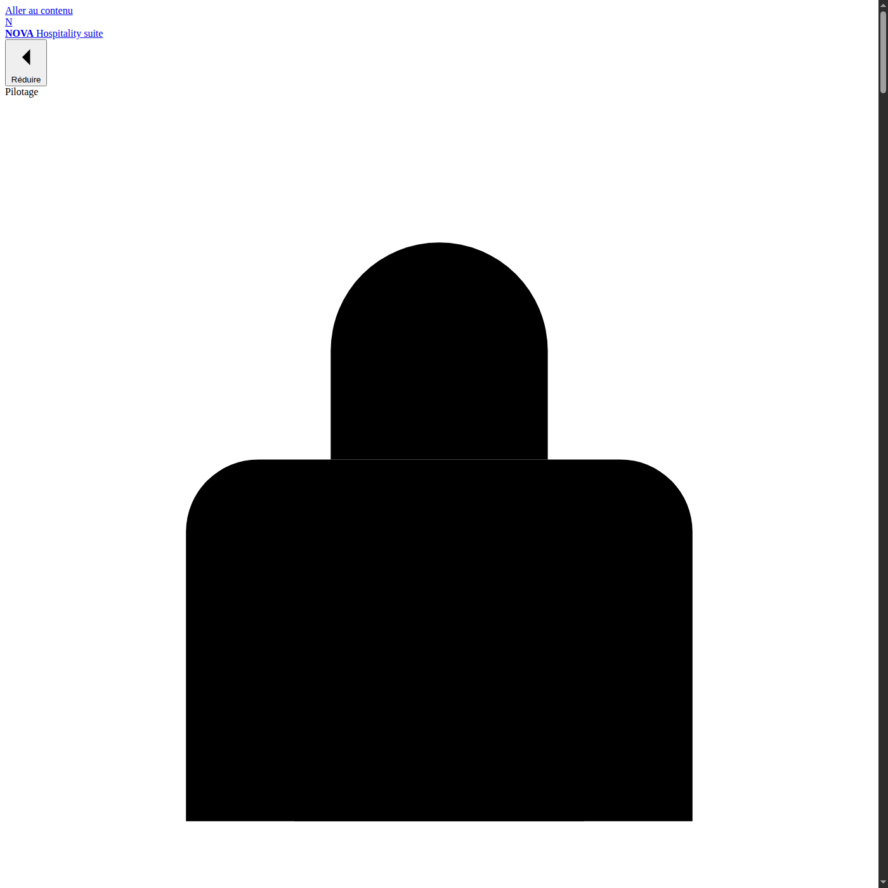
*Création/modification d’une réservation.*

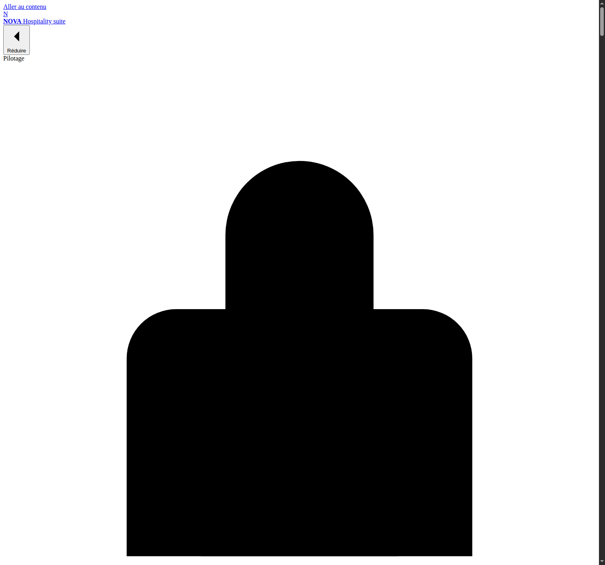
*Liste des réservations (module Hôtel).*

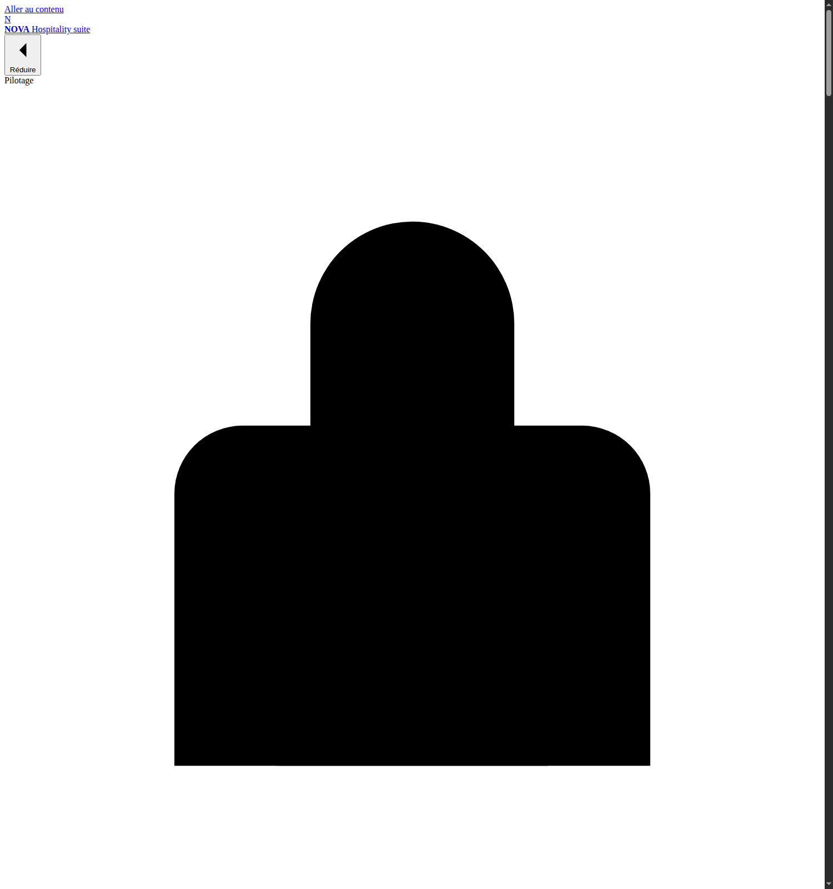
*Fiche détaillée d’une chambre (statut, séjour, tâches).*

### 5.4 Chef de cuisine (`Chef`)
**Objectif** : piloter la production cuisine et la disponibilité des plats.

- **Espace** : Cuisine (KDS) — files « à lancer », « en préparation », « prêtes », temps d’attente, historique.
- **Commandes** : démarrer la préparation et marquer une commande prête. (L’annulation d’une commande est gérée par le service/réception/gérance selon les droits.)
- **Carte** : activer/désactiver la disponibilité des plats.
- **Stocks** : consulter les niveaux/alertes et **signaler un besoin de réapprovisionnement** (trace dans le journal) ; consulter les mouvements récents.
- **Accès modules** : Restaurant, Inventaire, Clients & équipe. Pas d’accès caisse/finance, bar, ni réception.

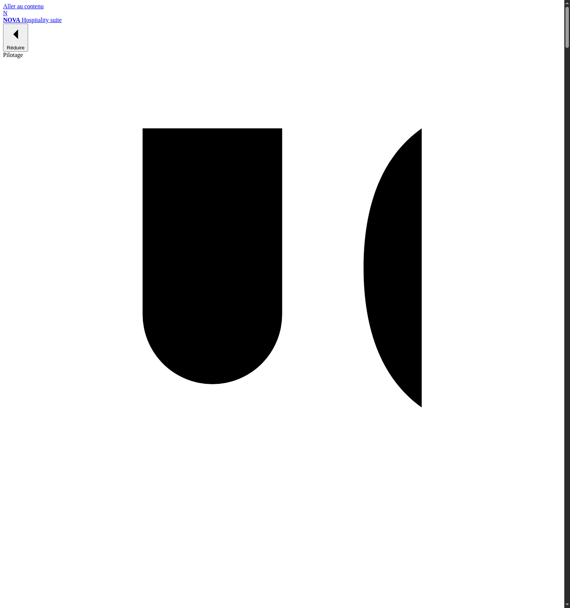
*Écran cuisine (KDS) et suivi des commandes.*

### 5.5 Serveur (`Waiter`)
**Objectif** : prise de commande et service en salle et au bar (espace unifié).

- **Espace** : Service salle & bar — plan des tables restaurant et bar, commandes en cours, alertes « à servir / addition ».
- **Prise de commande** : créer une commande (restaurant ou bar), en brouillon ou envoyée ; modifier un brouillon ; choisir table/mode/client et articles.
- **Suivi** : faire avancer/servir selon l’étape, associer un client, **transmettre l’addition à la caisse** (facturation), imprimer tickets commande/facture.
- **Règles** : le serveur peut préparer/transmettre l’addition mais **n’encaisse pas** les paiements. Certaines actions (ex. démarrage préparation cuisine/bar) suivent le flux prévu par rôle.
- **Accès modules** : Restaurant, Bar, Clients & équipe.

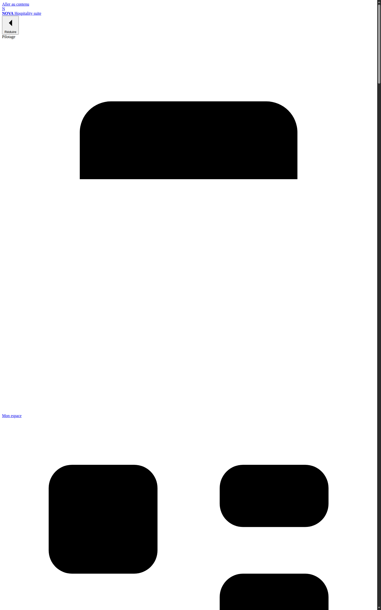
*Espace serveur unifié (tables et commandes restaurant/bar).*

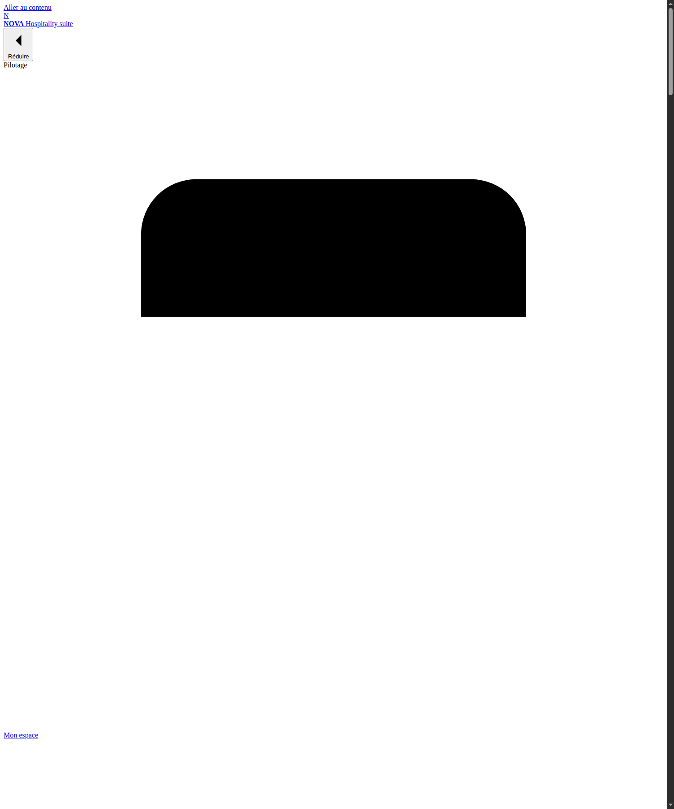
*Prise/modification de commande.*


*Fiche détaillée d’une table restaurant.*

### 5.6 Barman (`Bartender`)
**Objectif** : gérer le comptoir/bar et les commandes de boissons.

- **Espace** : Bar — tables/comptoir, commandes actives, commandes servies, carte des boissons, additions transmises, stocks/alertes.
- **Commandes bar** : créer/modifier (brouillon), démarrer, marquer servie, annuler si non facturée, associer un client, transmettre l’addition à la caisse, imprimer tickets.
- **Stocks** : consulter alertes et signaler un besoin de réapprovisionnement.
- **Règles** : le barman ne peut pas encaisser ; l’encaissement est réalisé en caisse.
- **Accès modules** : Bar, Clients & équipe.

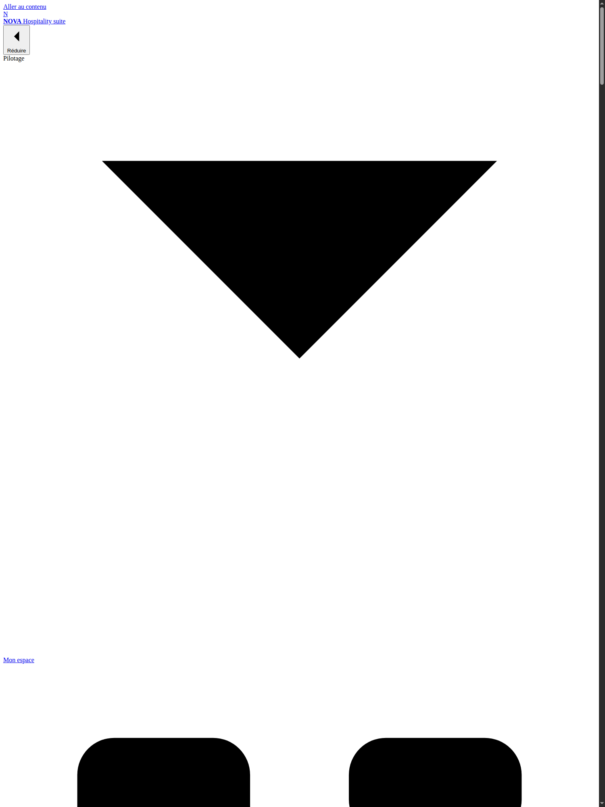
*Espace bar (tables, commandes, boissons).*

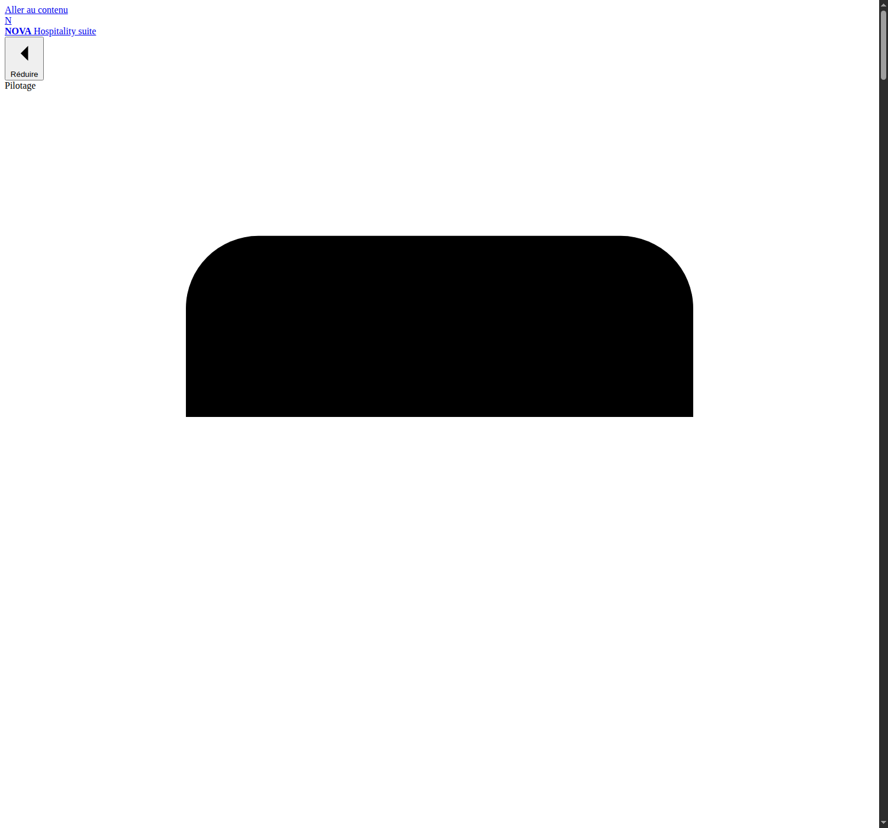
*Fiche détaillée d’une table de bar.*

### 5.7 Caissier (`Cashier`)
**Objectif** : encaisser les factures et suivre les montants.

- **Espace** : Caisse — encaissé du jour et répartition par moyen, **à encaisser** (soldes ouverts), factures en attente, additions à facturer/encaisser (restaurant & bar), registre des factures, derniers paiements.
- **Encaissement** : ouvrir une facture payable et **enregistrer un paiement** (total ou partiel) avec le moyen de paiement et une référence éventuelle ; consulter/imprimer le reçu ou le ticket.
- **Facturation depuis le service** : préparer la facture d’une addition servie (restaurant/bar) si elle n’existe pas encore, puis encaisser.
- **Important** : il n’y a plus de sessions de caisse — les paiements sont enregistrés directement et comptabilisés sur la facture.
- **Accès modules** : Finance, Clients & équipe. Le **bilan financier par période** est réservé au Superadmin et au Gérant.
- **Limites** : ne crée pas les séjours/commandes ; il encaisse les factures émises/partiellement payées.

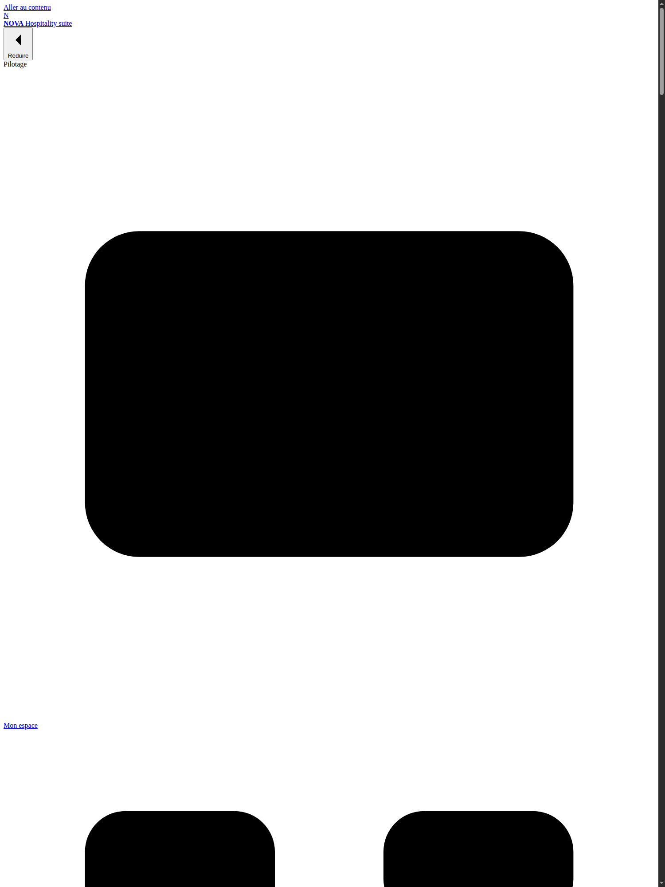
*Espace caisse : montants à encaisser/encaissés et factures.*

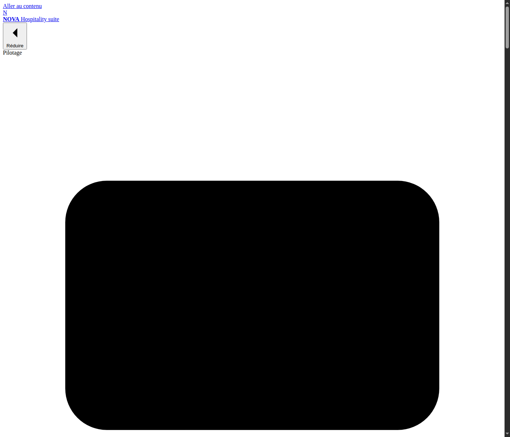
*Enregistrement d’un paiement (total ou partiel).*

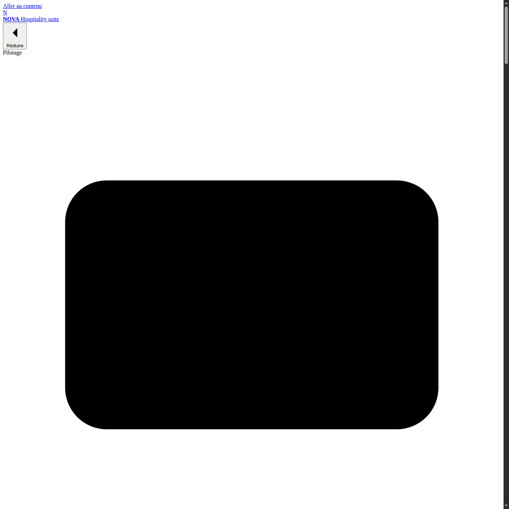
*Reçu / justificatif d’encaissement.*

---

## 6. Workflows et cycles de vie par activité

Cette section détaille, pour chaque activité, les étapes du flux, les rôles impliqués, les statuts et les transitions.

### 6.1 Hôtel — demande web, réservation, séjour et départ

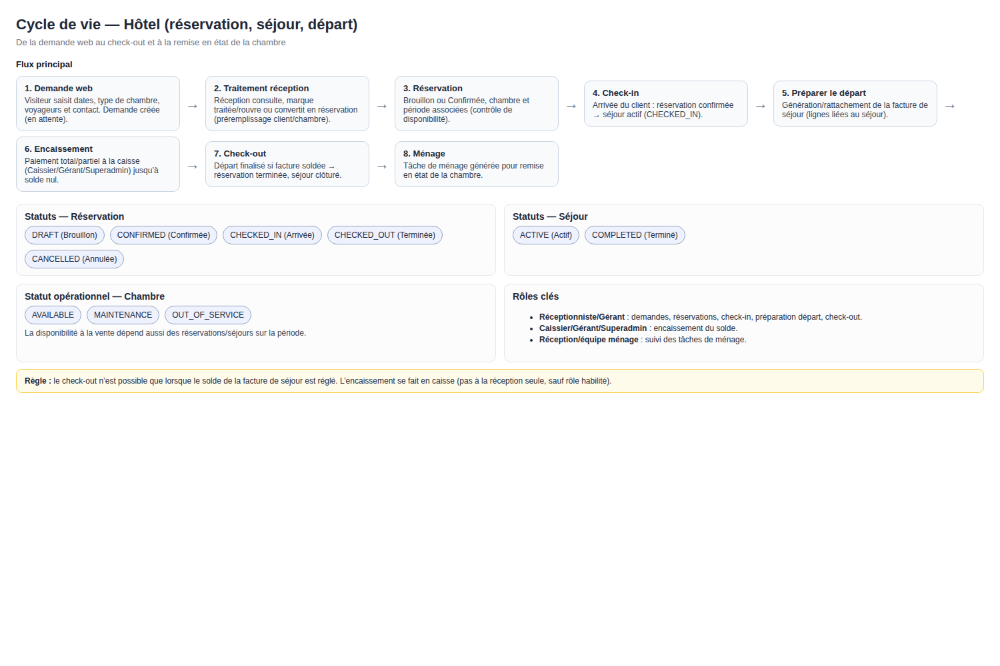

**Étapes du flux**
1. **Demande web (optionnel)** : le visiteur envoie une demande (type de chambre, dates, voyageurs, contact). La demande est créée en attente de traitement.
2. **Traitement à la réception** : la réception consulte la demande, peut la marquer traitée/rouvrir, puis la **convertir en réservation** avec préremplissage (client/chambre/dates) selon disponibilité.
3. **Réservation** : créée en **Brouillon** (`DRAFT`) ou **Confirmée** (`CONFIRMED`) avec chambre, période et client (contrôle des conflits de période sur les réservations confirmées/en arrivée).
4. **Check-in (arrivée)** : pour une réservation confirmée, l’arrivée crée/active le séjour et fait passer la réservation en **Arrivée** (`CHECKED_IN`) ; le séjour devient **Actif** (`ACTIVE`).
5. **Préparer le départ** : génération ou rattachement de la **facture de séjour**.
6. **Encaissement** : paiement total ou partiel enregistré à la caisse (Caissier/Gérant/Superadmin) jusqu’au solde nul.
7. **Check-out (départ)** : possible uniquement si la facture est soldée ; la réservation passe à **Terminée** (`CHECKED_OUT`) et le séjour à **Terminé** (`COMPLETED`).
8. **Ménage** : une tâche de remise en état est générée après le départ (voir 6.5).

**Statuts et transitions**
- **Réservation** : `DRAFT` (brouillon) → `CONFIRMED` (confirmée) → `CHECKED_IN` (arrivée/séjour en cours) → `CHECKED_OUT` (terminée). `CANCELLED` (annulée) selon le cas.
- **Séjour** : `ACTIVE` → `COMPLETED`.
- **Chambre (opérationnel)** : `AVAILABLE`, `MAINTENANCE`, `OUT_OF_SERVICE` (la disponibilité à la réservation dépend aussi des périodes occupées).

**Rôles** : Réceptionniste/Gérant (demandes, réservations, check-in, préparation départ, check-out) ; Caissier/Gérant/Superadmin (encaissement) ; équipe de ménage (exécution des tâches).

### 6.2 Restaurant — commande, cuisine, service et paiement

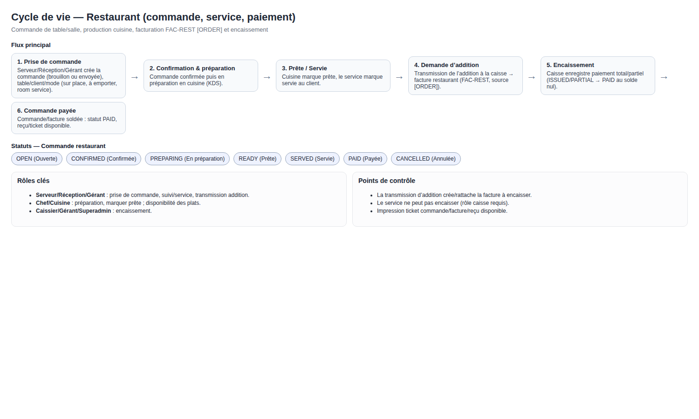

**Étapes du flux**
1. **Prise de commande** : créée par Serveur/Réception/Gérant (brouillon ou envoyée), avec table, client éventuel et mode (sur place, à emporter, room service) ; articles et quantités renseignés.
2. **Confirmation et préparation** : commande confirmée puis prise en charge en cuisine (KDS) — passage en préparation.
3. **Prête puis servie** : la cuisine marque la commande **Prête** (`READY`), le service la marque **Servie** (`SERVED`) au client.
4. **Transmission de l’addition** : envoi à la caisse → création/rattachement de la facture restaurant (référence `FAC-REST`, source `[ORDER]`).
5. **Encaissement** : paiement total/partiel à la caisse ; la facture passe de `ISSUED`/`PARTIAL` à `PAID` au solde nul.
6. **Clôture** : commande/facture soldée (statut `PAID`) avec reçu/ticket disponible.

**Statuts — Commande restaurant**
`OPEN` (ouverte) → `CONFIRMED` (confirmée) → `PREPARING` (en préparation) → `READY` (prête) → `SERVED` (servie) → `PAID` (payée). `CANCELLED` (annulée) possible selon l’état et les droits.

**Rôles** : Serveur/Réception/Gérant (prise de commande, service, transmission addition) ; Chef/Cuisine (préparation, plat prêt, disponibilité des plats) ; Caissier/Gérant/Superadmin (encaissement). Le service **n’encaisse pas**.

### 6.3 Bar — commande, préparation, service et paiement

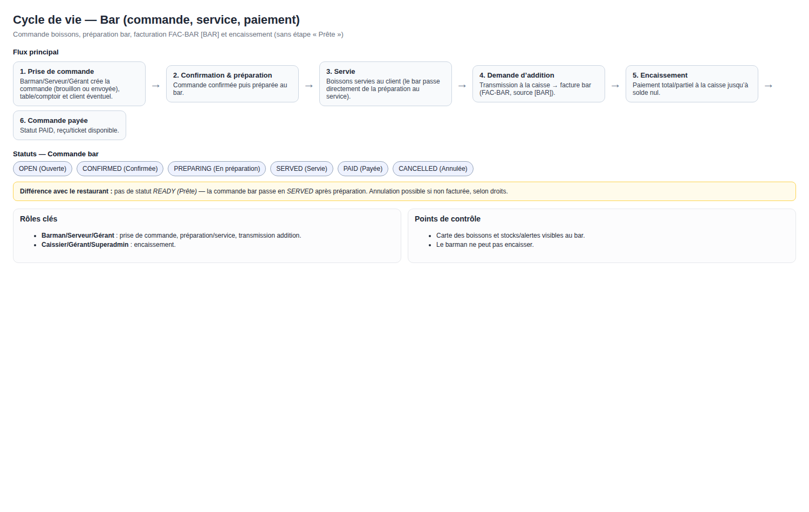

**Étapes du flux**
1. **Prise de commande** : créée par Barman/Serveur/Gérant (brouillon ou envoyée), table/comptoir et client éventuel.
2. **Confirmation et préparation** : commande confirmée puis préparée au bar.
3. **Servie** : boissons servies au client (le flux bar passe directement de `PREPARING` à `SERVED`, **sans étape « Prête »**).
4. **Transmission de l’addition** : envoi à la caisse → facture bar (référence `FAC-BAR`, source `[BAR]`).
5. **Encaissement** : paiement total/partiel à la caisse jusqu’au solde nul.
6. **Clôture** : commande/facture soldée (`PAID`) avec reçu/ticket.

**Statuts — Commande bar**
`OPEN` → `CONFIRMED` → `PREPARING` → `SERVED` → `PAID`. `CANCELLED` possible si non facturée, selon les droits.

**Rôles** : Barman/Serveur/Gérant (prise de commande, préparation/service, transmission addition) ; Caissier/Gérant/Superadmin (encaissement). Le barman **n’encaisse pas**.

### 6.4 Facturation, encaissement et bilan financier

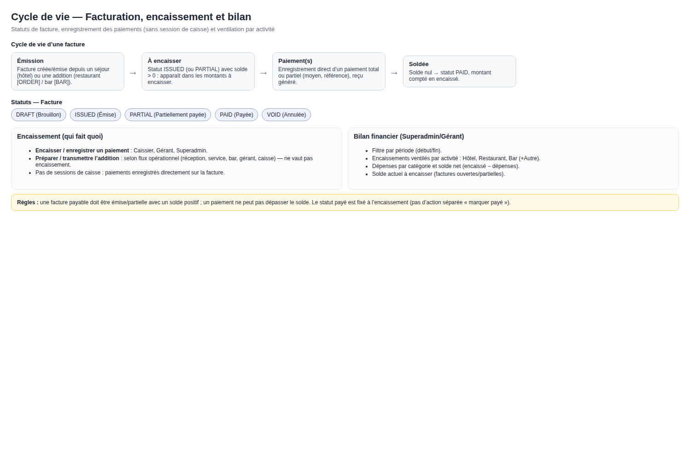

**Cycle de vie d’une facture**
1. **Émission** : facture créée/émise depuis un séjour hôtel ou une addition restaurant/bar (`[ORDER]`, `[BAR]`).
2. **À encaisser** : statut `ISSUED` (émise) ou `PARTIAL` (partiellement payée) avec solde > 0.
3. **Paiement(s)** : enregistrement direct d’un paiement (total ou partiel) avec moyen et référence éventuelle ; un reçu est généré. Il n’y a **plus de sessions de caisse**.
4. **Soldée** : solde nul → statut `PAID` ; le montant est comptabilisé en encaissé.

**Statuts — Facture** : `DRAFT` (brouillon), `ISSUED` (émise), `PARTIAL` (partiellement payée), `PAID` (payée), `VOID` (annulée).

**Règles et rôles**
- **Encaisser / enregistrer un paiement** : Caissier, Gérant, Super administrateur (les autres rôles opérationnels ne peuvent pas encaisser).
- **Préparer / transmettre une addition ou facture** : selon le flux opérationnel (réception, service, bar, caisse, gérant) — la préparation ne vaut pas encaissement.
- Le statut « payé » est fixé automatiquement à l’encaissement (aucune action séparée « marquer payé »). Un paiement ne peut pas dépasser le solde.
- **Bilan financier** (Superadmin/Gérant) : par période, encaissements ventilés par activité (Hôtel, Restaurant, Bar), dépenses par catégorie, solde net (encaissé − dépenses) et solde actuel à encaisser.

### 6.5 Ménage / housekeeping

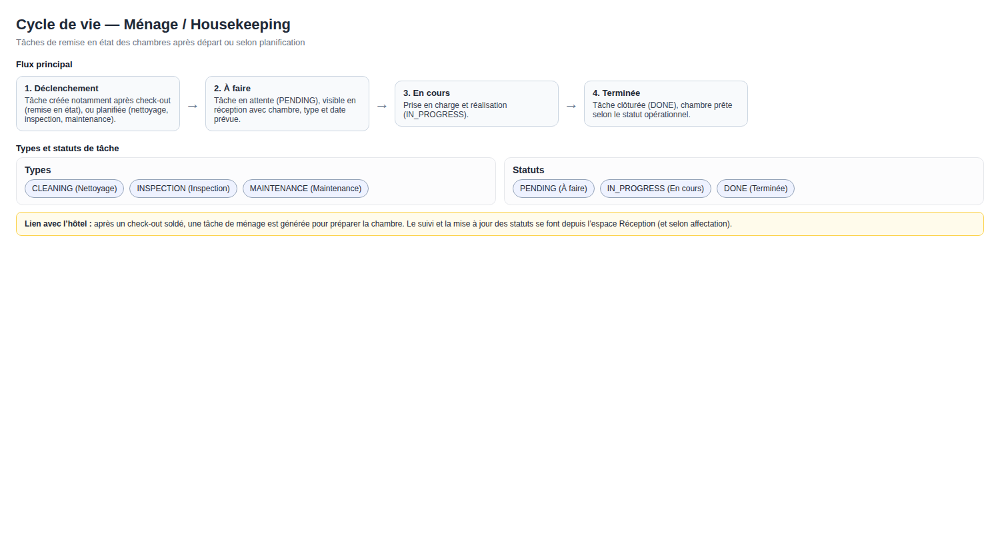

**Étapes du flux**
1. **Déclenchement** : tâche créée notamment après le check-out (remise en état), ou planifiée.
2. **À faire** (`PENDING`) : tâche visible avec chambre, type et date prévue.
3. **En cours** (`IN_PROGRESS`) : prise en charge et réalisation.
4. **Terminée** (`DONE`) : tâche clôturée, chambre prête selon son statut opérationnel.

**Types de tâche** : `CLEANING` (nettoyage), `INSPECTION` (inspection), `MAINTENANCE` (maintenance). **Statuts** : `PENDING` → `IN_PROGRESS` → `DONE`. Suivi et mise à jour depuis l’espace Réception (et selon affectation).

---

## 7. Bilan financier, rapports et impressions

- **Bilan financier** (`/workspace/finance/balance/`, Superadmin/Gérant) : choisir une période (début/fin) pour afficher les encaissements ventilés par activité (Hôtel, Restaurant, Bar), les dépenses par catégorie, le solde net (encaissé − dépenses) et le solde actuel à encaisser.
- **Rapports** (`/reports/`) : aperçu et génération/export (PDF/CSV) des états disponibles selon le rôle (factures, paiements, dépenses, réservations, ventes, stocks, audit, etc.) sur une période.
- **Impressions** : factures, reçus et commandes imprimables/téléchargeables ; mode ticket POS 80 mm disponible pour la caisse/service.

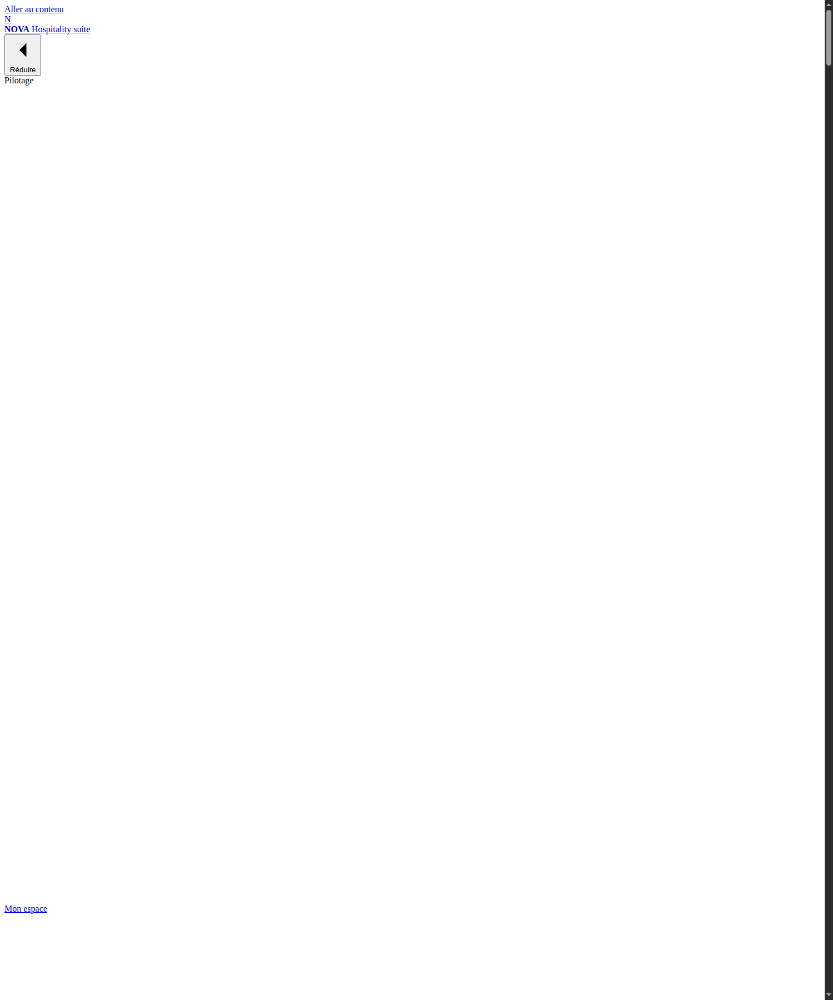
*Bilan financier par période (activités, dépenses, solde net).*

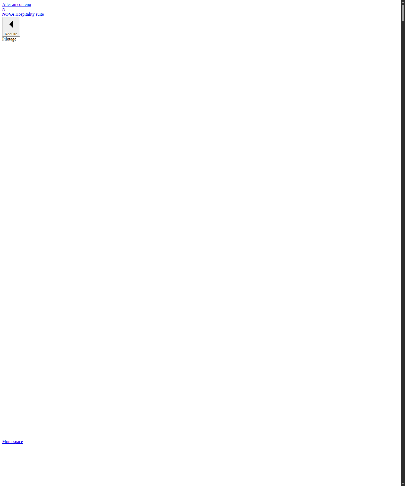
*Centre de rapports et documents.*

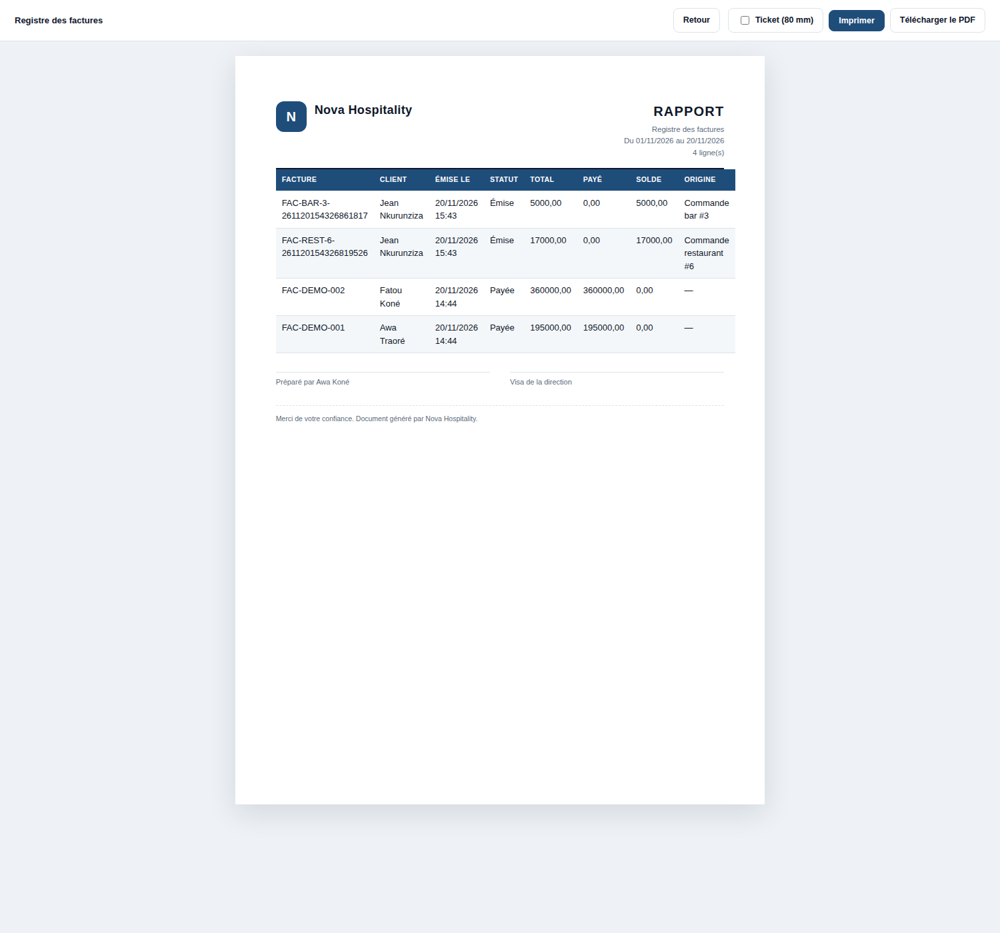
*Aperçu/impression d’un rapport sur période.*

---

## 8. OBR eBMS (facturation électronique)

- Le module OBR eBMS est désactivé par défaut et doit être **activé pour l’établissement** (profil société, action réservée au super administrateur).
- Une fois activé et configuré, il permet la gestion/synchronisation fiscale selon les écrans du module (`/obr-ebms/`) et les droits du rôle.
- La configuration et les tests de connexion doivent être réalisés avec les paramètres fournis pour l’environnement cible.

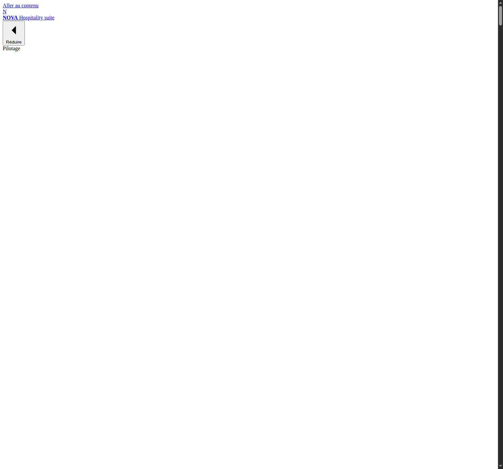
*Tableau de bord OBR eBMS (module activé).*

---

## 9. Bonnes pratiques et dépannage

- **Mots de passe** : changez les comptes de démonstration avant tout usage réel ; attribuez un rôle/groupe adapté à chaque utilisateur.
- **Droits** : si un écran/action est refusé, vérifiez le rôle/groupe du compte et l’espace prévu.
- **Paiement refusé** : seules les factures émises ou partiellement payées avec un solde positif sont encaissables ; un montant ne peut pas dépasser le solde.
- **Check-out hôtel bloqué** : le départ se finalise après encaissement du solde de la facture de séjour.
- **Données manquantes** : exécutez `python3 manage.py seed_demo` pour (ré)initialiser les données de référence/démo (idempotent). Pour une base vide, réinitialisez la base puis `migrate` + `seed_demo`.
- **PDF** : la génération PDF requiert les dépendances prévues (ex. `reportlab`) ; en leur absence, certaines exportations/tests PDF peuvent être indisponibles.
- **Vérification** : `python3 manage.py check` et `python3 manage.py test` permettent de valider l’état de l’application.

---

*NOVA Hospitality — guide d’utilisation. Bonne utilisation et plein succès dans la gestion de votre établissement.*
